# SafeC — Ownership and Memory-Safety Compiler

SafeC is a teaching compiler for a small C-like language. It adds explicit
ownership rules to heap pointers and checks their lifetimes before generating C.
The project also includes a browser demo that walks through the compiler stages,
highlights the source lines involved, and displays each intermediate form.

> **Project:** Compiler Design · **Focus:** Static ownership analysis · **Language:** Python 3, no Python dependencies

| | |
|---|---|
| **Repository** | [Open the SafeC GitHub repository](https://github.com/dev-sathasivam18/safec-ownership-compiler) |
| **Evaluation** | [View the full 30-program results](RESULTS.md) |
| **Review walkthrough** | [Open the demo and presentation guide](REVIEW_GUIDE.md) |
| **Screenshot gallery** | [Browse all 11 browser-demo screenshots](screenshots/README.md) |

---

## Project description

SafeC supports integer values, one-level `int*` pointers, functions, branches,
loops, allocation, and explicit `free`. An `own int*` value has one owner.
Assigning it to another owner, passing it to an owning parameter, or returning
it transfers ownership. A plain `int*` function parameter is borrowed and cannot
consume the allocation.

The compiler rejects common lifetime errors before it emits C, including
use-after-free, double-free, use-after-move, and leaks at scope exit or return.

## Compiler pipeline

| Stage | Input → output | Purpose |
|---|---|---|
| **Lexer** | Source characters → tokens | Recognizes keywords, identifiers, numbers, and operators. |
| **Parser** | Tokens → abstract syntax tree | Checks SafeC grammar and builds a structured program tree. |
| **Semantic analysis** | AST → typed, resolved symbols | Checks names, types, function calls, arguments, and return values. |
| **CFG construction** | AST → basic blocks and ownership IR | Represents branches and loops as control-flow edges and ownership operations. |
| **Ownership analysis** | CFG → converged ownership facts | Propagates `Uninit`, `Owned`, `Moved`, and `Freed` states to a fixed point. |
| **C code generation** | Verified AST → C source | Emits ordinary C only after all checks pass. |

The ownership analysis joins possible states at branches and iterates through
loops until the data-flow facts stop changing. It is path-insensitive: it
considers both sides of a branch without evaluating the condition.

## Features

- **Single ownership:** owned pointers move when transferred; they cannot be
  copied into a second owner.
- **Borrowed parameters:** functions can inspect or update a pointer without
  taking responsibility for freeing it.
- **Static lifetime checks:** diagnoses use-after-free, double-free,
  use-after-move, leaks, and possibly-freed values.
- **Control-flow view:** prints the basic blocks and ownership instructions for
  each function.
- **Guided browser walkthrough:** Previous/Next controls step through source,
  tokens, AST, symbols, CFG, ownership facts, and generated C. Each step has an
  explanation, a pipeline diagram, and highlighted source lines.
- **Bundled examples:** 15 intended-safe programs and 15 programs with injected
  ownership bugs, plus longer examples for the review walkthrough.
- **C output:** accepted programs are translated to C and can be compiled with
  GCC.

## Technologies used

- Python 3 standard library for the compiler and local demo server
- HTML, CSS, and JavaScript for the interactive browser frontend
- C as the generated target language
- GCC and AddressSanitizer for the optional runtime comparison

## Evaluation results

| Check | Result |
|---|---:|
| Safe examples accepted | 15/15 |
| Unsafe examples rejected with the expected error class | 15/15 |
| Safe examples incorrectly rejected | 0/15 |
| Generated C for safe examples ran clean under AddressSanitizer | 15/15 |
| Buggy examples caught by `gcc -Wall` | 3/15 |
| Buggy examples caught by AddressSanitizer | 5/15 |

AddressSanitizer ran with LeakSanitizer disabled because some runtimes do not
support it. SafeC's static leak checks are included in its compile-time results.
The example suite demonstrates the implementation against its own specification;
it is not a general-purpose C safety guarantee. See [RESULTS.md](RESULTS.md)
for per-program results and comparison details.

## Screenshots

These screenshots were captured from the running browser demo. The complete
screen captures are also listed in [screenshots/README.md](screenshots/README.md).

### 1. SafeC demo overview

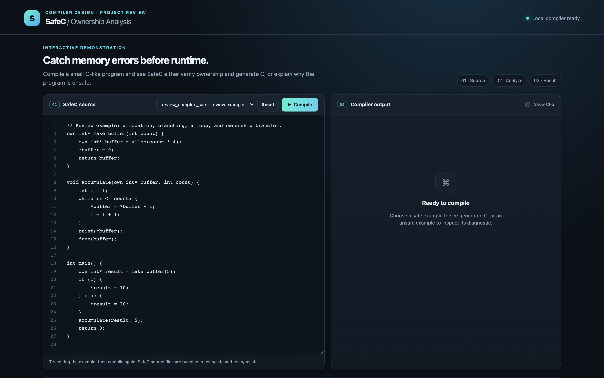

### 2. Safe program accepted and C generated

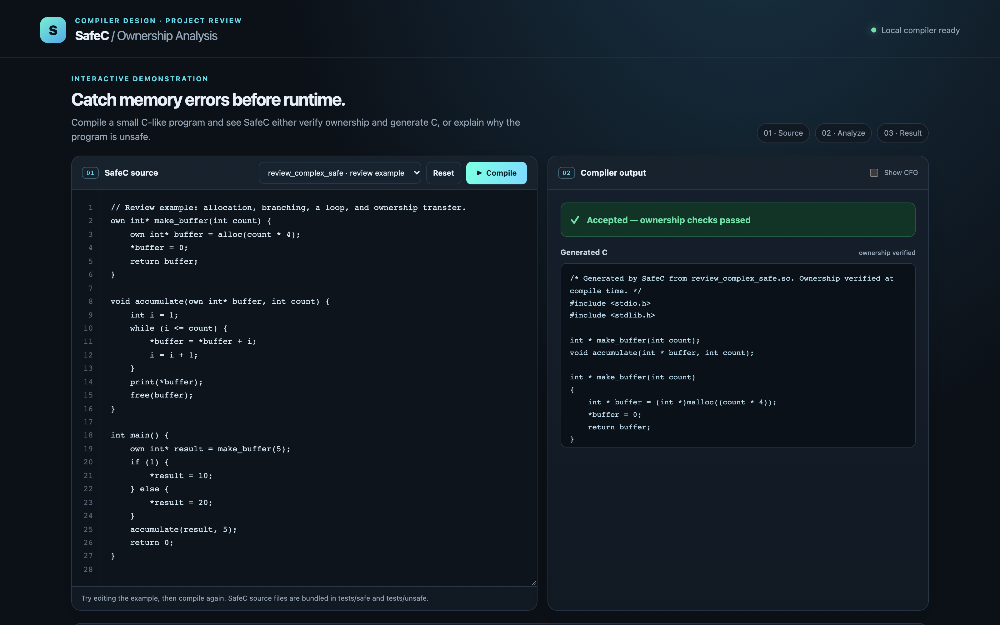

### 3. Unsafe program rejected with ownership diagnostics

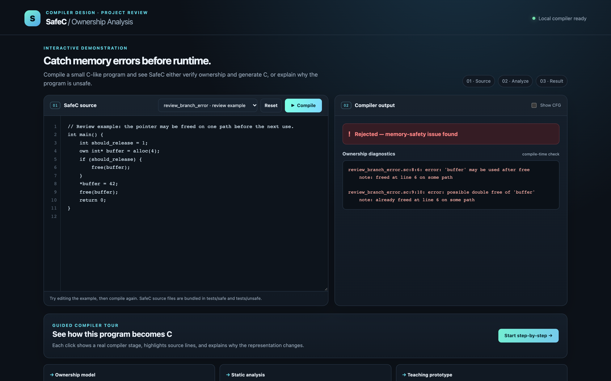

### 4. Control-flow graph

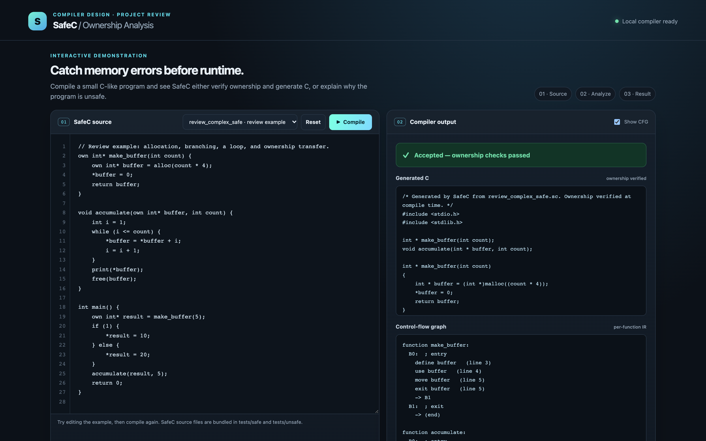

### 5. Guided walkthrough — source program

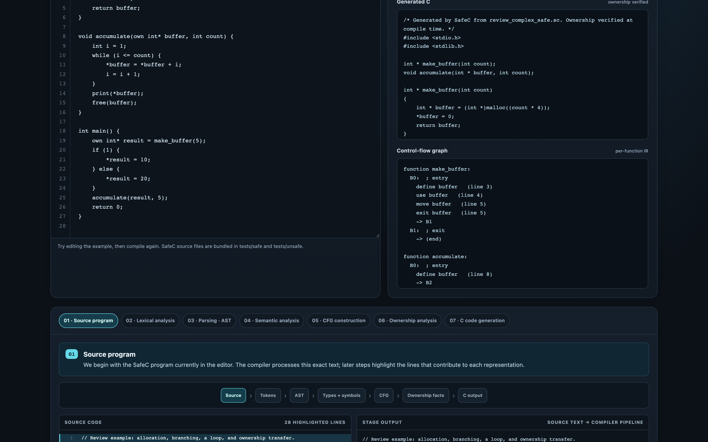

### 6. Guided walkthrough — lexical analysis

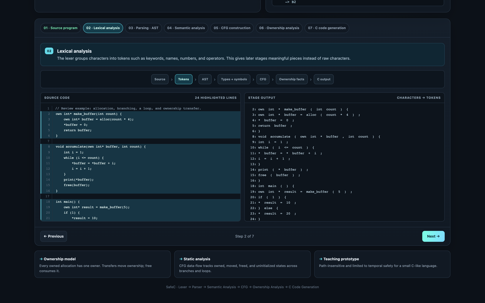

### 7. Guided walkthrough — parsing and AST

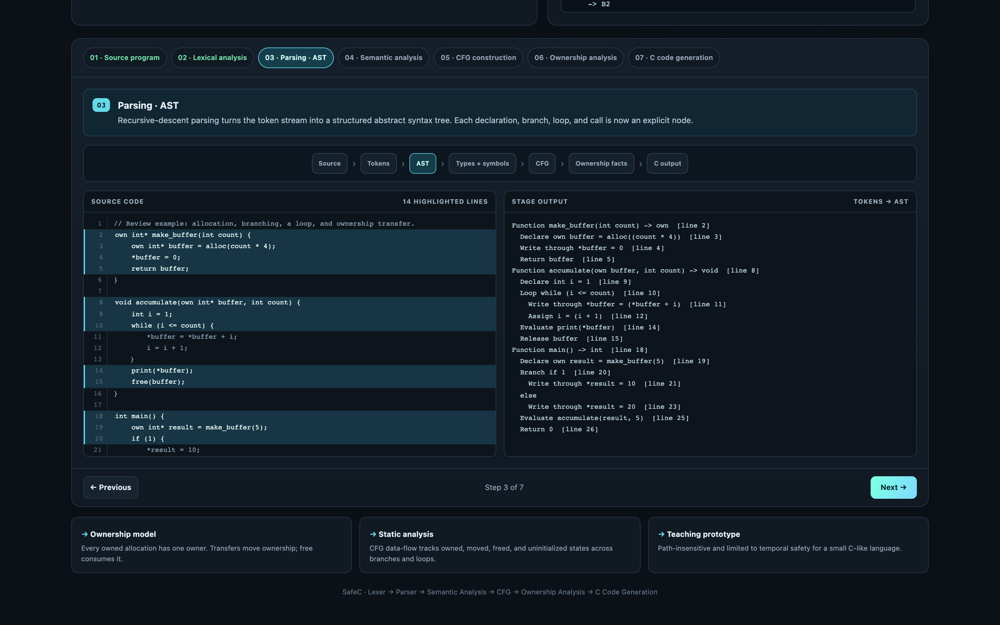

### 8. Guided walkthrough — semantic symbols

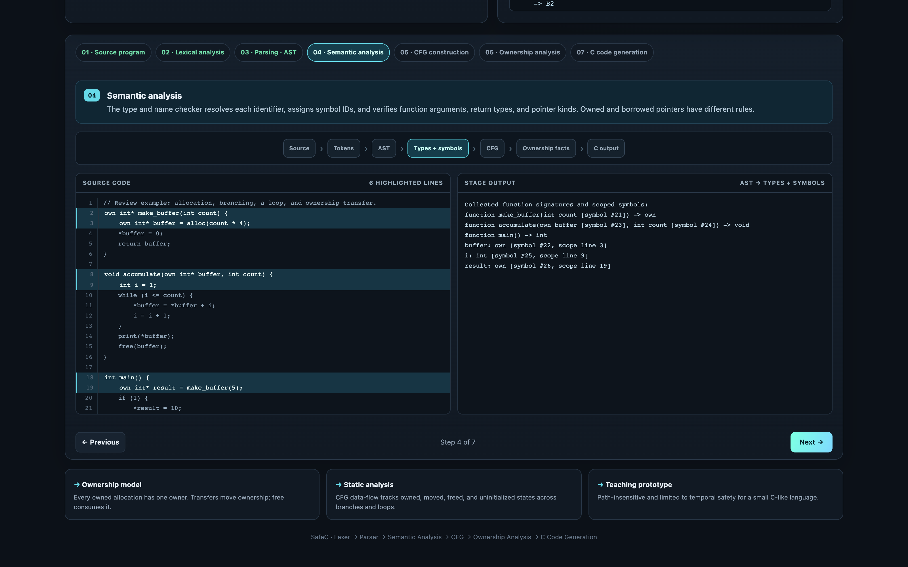

### 9. Guided walkthrough — control-flow graph

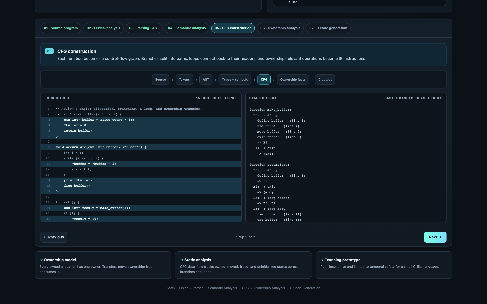

### 10. Guided walkthrough — ownership fixed point

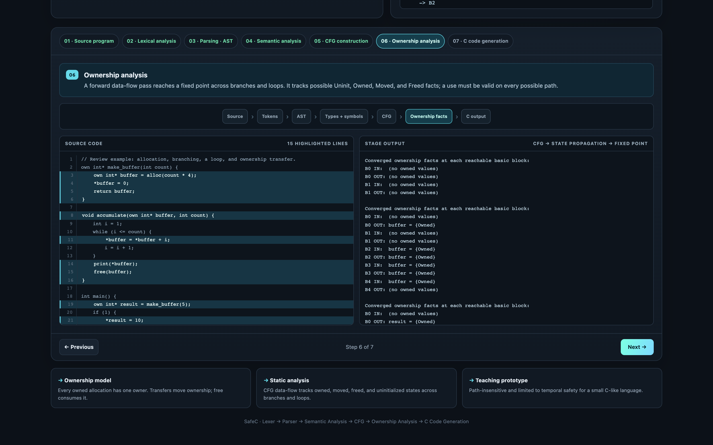

### 11. Guided walkthrough — generated C

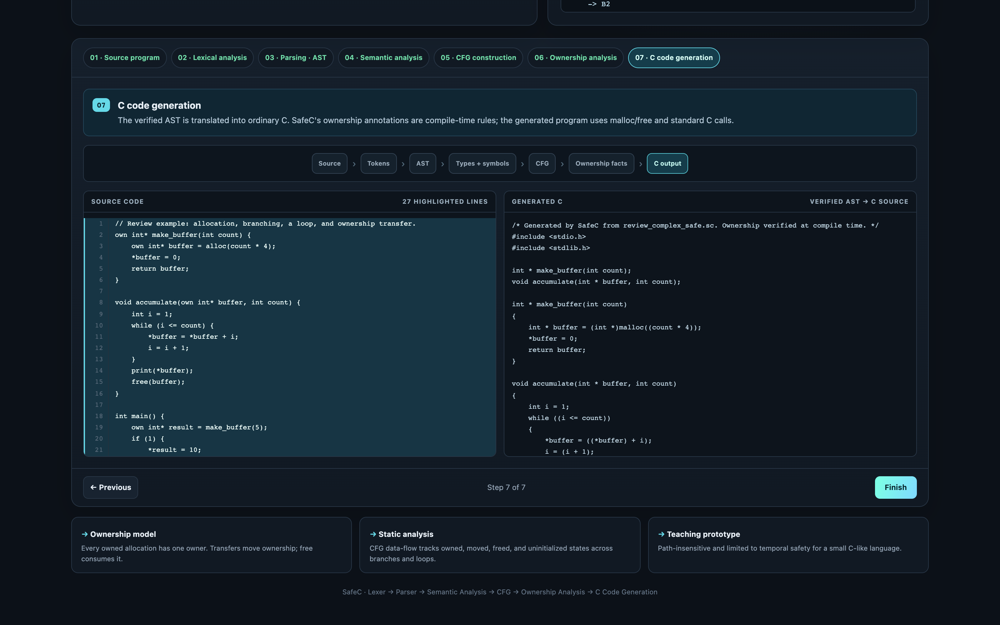

## How to run

Requires Python 3. GCC is optional and needed only for compiling generated C
or running the evaluation script. No Python packages are required.

### Compile a SafeC program

```bash
python3 -m safec tests/safe/s02_transfer_to_function.sc -o /tmp/safec_demo.c
gcc -Wall /tmp/safec_demo.c -o /tmp/safec_demo
/tmp/safec_demo
```

### Show the control-flow graph

```bash
python3 -m safec tests/safe/s04_branch_both_free.sc --emit-cfg
```

### See a compile-time ownership error

```bash
python3 -m safec tests/unsafe/u01_use_after_free.sc
```

The compiler prints a source location and diagnostic and exits without generating
C for an unsafe program.

### Start the browser demo

```bash
python3 demo_server.py
```

Open <http://127.0.0.1:8000>. Choose an example and click **Compile**, or select
`review_complex_safe` and click **Start step-by-step** for the full compiler
walkthrough. Stop the local server with Ctrl+C.

### Run the evaluation

```bash
python3 evaluate.py
```

This regenerates `RESULTS.md` and requires GCC with AddressSanitizer support.

## Language example

```c
void consume(own int* value) {
    free(value);              // callee receives and consumes ownership
}

int main() {
    own int* p = alloc(4);    // p owns a 4-byte allocation
    *p = 10;
    print(*p);
    free(p);                  // releases the allocation

    own int* q = alloc(4);
    consume(q);               // q is moved; do not use it afterward
    return 0;
}
```

An owned variable passed to `consume` is moved and cannot be used afterward.
Borrowed parameters use `int*` and cannot free or move the allocation.

## Repository structure

```text
SafeC/
├── safec/                 Compiler: lexer, parser, semantic checks, CFG, analysis, C output
├── tests/
│   ├── safe/              15 expected-safe programs
│   └── unsafe/            15 expected-unsafe programs
├── examples/              Longer safe and unsafe review examples
├── screenshots/            Browser demo screenshots for presentations
├── demo.html               Interactive compiler frontend
├── demo_server.py          Local Python server and compiler walkthrough API
├── evaluate.py             GCC and AddressSanitizer comparison
├── RESULTS.md              Per-program evaluation results
└── REVIEW_GUIDE.md         Suggested project-review walkthrough
```

## Scope and limitations

- The analysis is path-insensitive and may reject code that is safe only because
  of a relationship between branch conditions.
- SafeC supports `int` and one pointer level (`int*`); it does not model arrays,
  structs, pointer aliasing, or bounds safety.
- The checks cover temporal memory safety, not spatial errors such as
  out-of-bounds writes.
- The parser stops at its first syntax error. `break`, `continue`, and `for` are
  not implemented.
